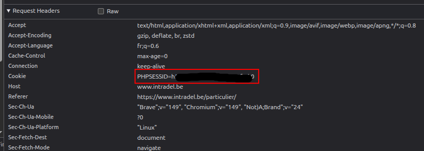

[](https://github.com/custom-components/hacs)


# Intradel integration

## Installations

- Through HACS [custom repositories](https://hacs.xyz/docs/faq/custom_repositories/) !
- Otherwise, download the zip from the latest release and copy `intradel` folder and put it inside
  your `custom_components` folder.

You can configure it through the UI using integration.

Authentication is done with a **session cookie** only. The Intradel login form is protected
by an invisible reCAPTCHA that the site verifies server-side, so a plain username/password
request is always rejected (`La vérification anti-spam a échoué`) — that method is therefore
not offered. Log in once in a regular browser and paste the resulting session cookie.

Capturing the cookie by hand should rarely be needed again afterwards: the integration pings
the site regularly so the session never goes stale.

### How to get the session cookie

1. Open [https://www.intradel.be/particulier/](https://www.intradel.be/particulier/) in your
   browser and log in with your username, password and town.
2. Open the developer tools (`F12`, or right-click anywhere on the page and choose
   **Inspect**), then go to the **Network** tab.
3. Reload the page (`F5`) so a request to the site shows up in the list.
4. Click on the first request (e.g. `particulier` or `data.php`), open its **Headers**, and
   find the **Cookie** header under **Request Headers**.

   

5. Copy the full value of that header and paste it in the `Session cookie` field of the
   integration configuration.

The cookie is a session token: if it expires, the integration will ask you to repeat these
steps to provide a fresh one.

## Options

| Option | Default | Meaning |
| --- | --- | --- |
| Minutes between scans | 720 | How often the data is fetched. |
| Minutes between keep-alive pings | 15 | Keeps the session cookie alive; 0 disables it. |

## Provided entities

### organic/residual waste sensor

The `state` is total weight of waste of the **current year**.
The attribute `details` contains the details of bin collection (weight and date).
The attribute `start_date` is basically 01-01 of the current year.

### recyparc sensor

The `state` is the number of visit of the **current year**.
The attribute `details` contains the details of the visits (detail/volume and date) 
The attribute `start_date` is basically 01-01 of the current year.

## Development

Requires Python 3.13. Tests run against the minimum supported Home Assistant (`hacs.json`),
pinned through `pytest-homeassistant-custom-component` in `requirements_test.txt`, with that
Home Assistant release's own dependency constraints:

```bash
python3.13 -m venv .venv && . .venv/bin/activate
pip install -r requirements_test.txt \
  -c "https://raw.githubusercontent.com/home-assistant/core/$(jq -r .homeassistant hacs.json)/homeassistant/package_constraints.txt"
pytest
ruff check
ruff format
mypy
```

Install the git pre-commit hook once per clone (`pip install pre-commit && pre-commit install`);
it runs the checks of `.pre-commit-config.yaml`, with the ruff of the activated virtualenv.

CI also runs these checks against the latest Home Assistant release (Python 3.14).

To release, bump `version` in `custom_components/intradel/manifest.json`, then publish a
GitHub release whose tag is that same version (e.g. `0.1.2`); CI fails the release otherwise.

---
<a href="https://www.buymeacoffee.com/tgermain" target="_blank"></a>
